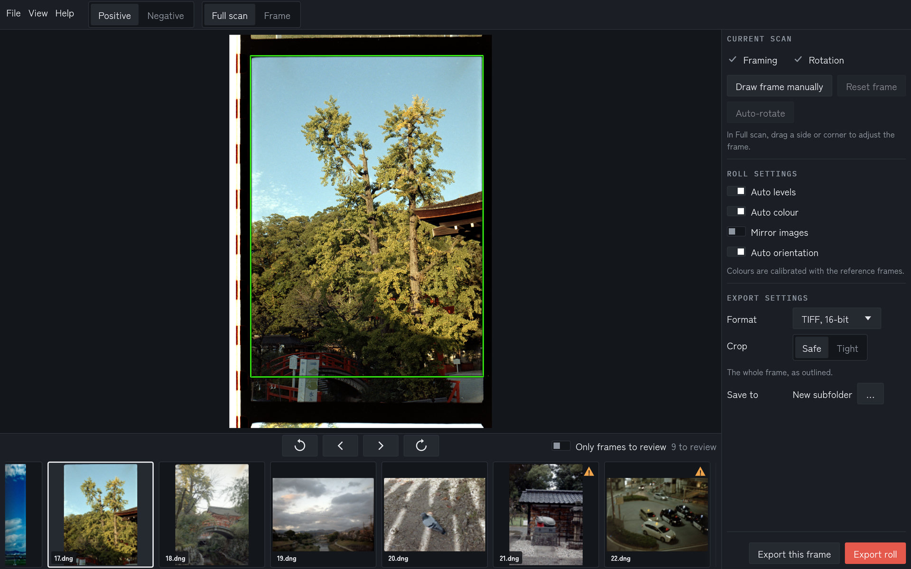
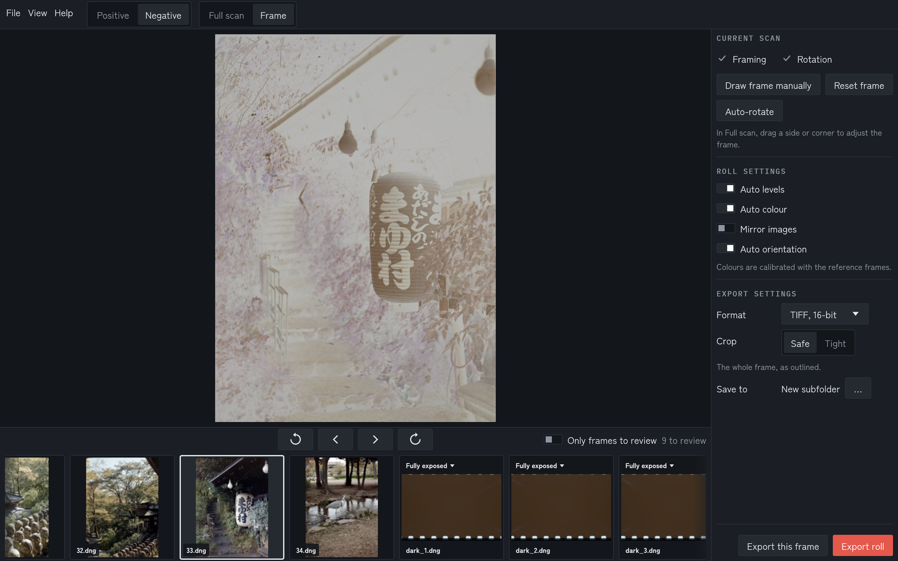
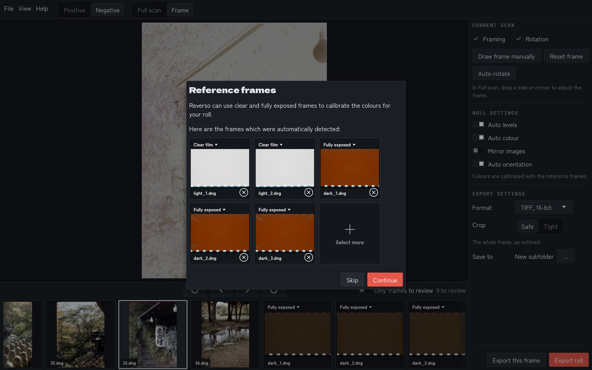

# Reverso - [Download](https://github.com/lensvault/reverso-releases/releases/latest)

Reverso turns camera scans of film negatives into positives. It finds the frame, inverts the negative, balances the colours and turns each picture the right way up, for a whole roll at a time.

Windows only (64-bit).

Each scan is inverted, framed and turned upright automatically, with the whole roll in the strip below.

## Negative and frame views

Switch between the negative and the positive, and between the full scan and the cropped frame. Reference frames sit at the end of the roll.

## Reference frames

Reverso finds the clear-film and fully exposed frames by itself and uses them to calibrate the roll's colours.

## Download

1. Open [Releases](https://github.com/lensvault/reverso-releases/releases/latest) and download `reverso-<version>-windows-x64.exe`.
2. Run it. Windows may warn that the app is from an unknown publisher; choose More info → Run anyway.

Licences for the software Reverso is built with are under Help → About Reverso.
